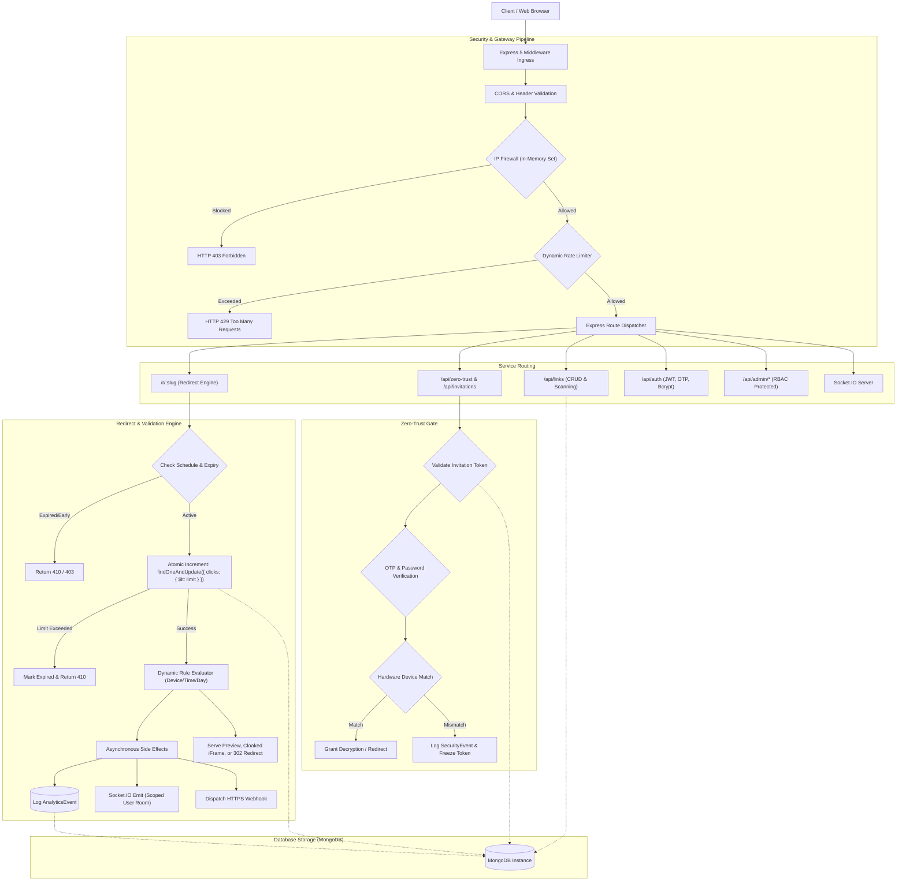

# 🔗 VanishLink: Enterprise-Grade Ephemeral Link & Zero-Trust Secret Sharing Platform

> **Comprehensive System Specification & Architecture Overview**  
> *A production-hardened platform for time-sensitive, self-destructing data distribution, device-bound zero-trust access control, and dynamic traffic routing.*

---

## 1. Executive Summary

**VanishLink** is an advanced, privacy-first ephemeral link management and zero-trust data exchange platform. While standard link shorteners (e.g., Bitly, TinyURL) permanently map a static alias to a URL, VanishLink transforms links into **ephemeral, programmable, and context-aware security envelopes**.

VanishLink allows organizations and individuals to share sensitive URLs, credentials, announcements, and confidential payloads with mathematical certainty that access will be strictly restricted, monitored in real time, and permanently eradicated once predefined conditions are met. 

The platform features:
- **Autonomous Self-Destruction:** Destruction triggers based on elapsed time (TTL), strict single-use ("burn after reading"), or cumulative click quotas with race-condition-immune atomic decrementing.
- **Zero-Trust Device Binding & Verification:** Recipient-specific invitation tokens that require multi-factor verification (Email OTP + Password) and bind cryptographically to the recipient’s hardware/browser fingerprint to prevent unauthorized link forwarding.
- **Dynamic Context-Aware Redirection:** A real-time routing engine that evaluates visitor context (device type, operating system, crawler bot signatures, time-of-day, day-of-week, and click counts) to route traffic to distinct destinations.
- **Automated Threat Intelligence & Moderation:** Heuristic pre-creation URL scanners and real-time banned-keyword enforcement with automated quarantining and a comprehensive abuse reporting workflow.
- **Real-Time Telemetry & Observability:** Live event streaming via WebSockets (Socket.IO), geolocational and device analytics, and automated webhook postbacks on access milestones.
- **Centralized Administrative Operations Suite:** Role-Based Access Control (RBAC), an IP blacklist firewall, live dynamic rate-limiting controls, and immutable audit logs.
- **Synchronized Collaborative Media (Watch Parties):** Dedicated virtual rooms for synchronized real-time media playback.

---

## 2. Problem Statement & Value Proposition

### The Modern Data Vulnerability Landscape

1. **The "Forever Data" Liability:** Sensitive credentials, API keys, password resets, private staging URLs, and confidential documents sent over communication channels (Slack, Microsoft Teams, Email, WhatsApp) persist indefinitely in chat histories, cloud backups, and third-party servers. If an account is breached months or years later, historical secrets are immediately compromised.
2. **The Forwarding & Leak Vulnerability:** Standard URLs are unrestricted. If a user sends a confidential link to a single vendor or contractor, nothing prevents that recipient from forwarding the link to external third parties.
3. **Blind Redirection Risks:** Traditional link shorteners hide the destination URL, creating an attack vector for phishing and malware. Recipients have no insight into where a link leads before clicking.
4. **Traffic Inefficiency:** Traditional links route all traffic to a single destination regardless of whether the user is on mobile or desktop, browsing during business hours or weekends, or if the visitor is a search engine bot.

### The VanishLink Solution

| Challenge | VanishLink Architectural Solution |
| :--- | :--- |
| **Data Lingering Forever** | **Cryptographic Ephemerality:** Links automatically expire, burn, or purge themselves from MongoDB using atomic locks and database-level TTL indices. |
| **Unauthorized Link Forwarding** | **Zero-Trust Device Anchoring:** Invitation tokens bind to the recipient's initial device fingerprint and IP address; forward attempts trigger instant security alerts and access denial. |
| **Phishing / Blind Access** | **Preview Gates & Automated Threat Scanners:** Target URLs are vetted by heuristic security engines upon creation, and recipients can view safety inspection cards before navigating. |
| **Static One-Size-Fits-All Redirection** | **Dynamic Multi-Variable Engine:** Dynamically routes visitors to alternate targets based on device OS, bot detection, time of day, and click volume. |
| **Race Conditions in Limited Access** | **Atomic Database-Level Guarantees:** Atomic conditional updates (`$lt` / `$inc`) eliminate race conditions, preventing limit bypasses under concurrent load. |

---

## 3. Core System Capabilities & Feature Breakdown

### 3.1. Ephemeral Link Lifecycle & Self-Destruction
- **Burn-After-Reading (One-Time Links):** The destination is served exactly once. The moment the initial authorized visitor loads the destination, the link is permanently marked as expired (HTTP 410 Gone) or physically purged.
- **Click Quotas (`maxClicks`):** Creators specify a hard limit on allowed visits (e.g., 5 views). MongoDB atomic conditional locks guarantee that exactly $N$ requests succeed, regardless of concurrent traffic spikes.
- **Time-To-Live Expiration (`expiresAt`):** Links expire at an exact millisecond timestamp. MongoDB native TTL indices ensure zero background CPU overhead for expired record purging.
- **Scheduled Access Delay (`scheduleStart`):** Links remain dormant (HTTP 403 Forbidden) until a designated future timestamp, enabling synchronized embargoed announcements, timed press releases, or digital dead-man switches.
- **Password-Gated Redirection:** Links can be shielded behind a password gate requiring credential entry before destination resolution.
- **Cloaked vs. Direct vs. Preview Modes:** Creators can choose between:
  1. *Direct 302 Redirect:* Instant forwarding to the destination.
  2. *Cloaked iFrame:* Displays destination content inside an obfuscated container with URL masking.
  3. *Preview Safety Card:* Displays rich metadata, domain safety analysis, and user reporting mechanisms prior to final redirect.

---

### 3.2. Zero-Trust Architecture & Recipient Binding
VanishLink implements a strict **Zero-Trust Link Sharing** paradigm designed for high-security enterprise workflows:
- **Unique Per-Recipient Invitation Tokens:** Rather than sharing a universal slug, the creator issues unique invitation tokens bound to specific recipient email addresses.
- **Multi-Factor Access Verification:** Access can require both an ephemeral 6-digit Email OTP (sent via Nodemailer) and a secret link password.
- **Hardware & Browser Device Fingerprinting:** Upon successful identity verification, the recipient's client environment (User-Agent, headers, screen resolution, canvas data, and IP) is fingerprinted and stored.
- **Leak Detection & Dynamic Freezing:** If a secondary actor attempts to open the same invitation link from a different device fingerprint, VanishLink detects the mismatch, records a `SecurityEvent` log, alerts the link owner, and can automatically freeze or revoke the token.
- **Recipient Management Dashboard:** Senders can view access logs per recipient, monitor active device sessions, and manually freeze or revoke individual invitations with one click.

---

### 3.3. Smart Dynamic Redirection Engine
Rather than mapping to a single static URL, VanishLink links can be programmed with conditional routing trees:
- **Device & Platform Routing:** Routes visitors to device-specific destinations (e.g., iOS App Store link for iPhones, Google Play Store for Android, Web app for desktop, and custom targets for search engine crawlers/bots).
- **Temporal & Time-of-Day Routing:** Directs traffic to alternate URLs during specific hours (e.g., routing to an on-call support dashboard during 09:00–17:00 and an emergency ticketing system after-hours).
- **Day-of-Week Routing:** Differentiates weekday traffic from weekend traffic.
- **Click-Tier Routing:** Directs early visitors (Clicks 1–100) to an early-bird destination, and subsequent visitors (Clicks 101+) to a standard landing page.

---

### 3.4. Content Moderation & URL Threat Intelligence
- **Heuristic URL Scanner:** Validates destination URLs against common malware, phishing domains, and suspicious pattern heuristics prior to link generation.
- **Banned Keywords Engine:** Automatically scans link titles and destination URLs against a dynamic database of restricted keywords. Flagged links are automatically created with a `status: 'blocked'`, preventing unauthorized redirects while generating a high-priority incident report.
- **Public Reporting Portal:** Every public preview card features an abuse submission modal with 8 distinct categories (Malware, Phishing, Spam, Copyright Violation, Illegal Content, Misleading, Inappropriate, Other).
- **Admin Moderation Suite:** Administrators can inspect reported links, review reporter comments, view threat priority levels, and perform atomic bulk or individual actions (Approve, Block, Delete, Reject).

---

### 3.5. Real-Time Telemetry, Analytics & Webhooks
- **Live WebSocket Streams:** Powered by Socket.IO, administrators and link owners receive live updates whenever a link is clicked. Link owners are scoped to private user rooms (`user_<id>`), ensuring strict multi-tenant privacy.
- **Rich Telemetry Collection:** Every visit captures timestamp, IP address, device family, operating system, browser, referrer source, and approximate country code.
- **Visual Analytics:** Interactive Recharts visual dashboards detailing click timelines, device breakdowns, and top referring channels.
- **Event-Driven Webhooks:** Configurable HTTPS webhooks dispatched on critical lifecycle events:
  - `first_click`: Triggered the moment a dormant or new link is opened.
  - `expiry`: Triggered when a link expires by time or click quota.
  - `one_time_complete`: Dispatched immediately upon single-use link consumption.

---

### 3.6. Collaborative Synchronized Watch Parties
- **Virtual Media Rooms:** Users can generate shared virtual rooms around video streams (e.g., YouTube integration).
- **Real-Time Room Management:** Hosts can create private or public rooms with room codes, track active participant counts, and stream media collaboratively.

---

### 3.7. Enterprise Admin Command Center & Security Suite
- **Role-Based Access Control (RBAC):** Distinct authorization tiers (`regular`, `premium`, `admin`) enforced through JWT token payload verification and server-side route guards.
- **In-Memory IP Firewall (`ipBlocker`):** Inspects incoming connections against an administrative blacklist, terminating malicious connections before they reach the application layer or database.
- **Dynamic Live Rate Limiting:** Rate limiters dynamically query threshold parameters from MongoDB, enabling administrators to adjust anti-abuse throttles in real time without restarting backend processes.
- **Immutable Audit Logging:** Every administrative action (blocking links, banning users, modifying firewall rules, updating global banned keywords) is recorded in an immutable audit ledger (`AuditLog`).

---

## 4. System Architecture & Request Lifecycle

### 4.1. High-Level Architecture Diagram



---

### 4.2. Request Lifecycle for an Ephemeral Redirect

1. **Ingress Filtering:** Incoming HTTP requests pass through the `ipBlocker` firewall, verifying the client IP is not blacklisted.
2. **Rate Limiting:** Requests hit `redirectLimiter` to throttle automated scraping tools and DDoS attacks.
3. **Lookup & State Verification:** The system queries the link by `slug`. It checks:
   - Is `scheduleStart` in the future? If yes $\rightarrow$ HTTP 403 Forbidden.
   - Is `expiresAt` in the past? If yes $\rightarrow$ HTTP 410 Gone.
   - Is `status === 'blocked'`? If yes $\rightarrow$ HTTP 403 Blocked.
4. **Atomic Concurrency Guarantee:** If `isOneTime` or `maxClicks` is configured, an atomic MongoDB conditional update is executed:
   ```javascript
   Link.findOneAndUpdate(
     { _id: link._id, clicks: { $lt: limit } },
     { $inc: { clicks: 1 } },
     { new: true }
   );
   ```
   If the update returns null, a concurrent request claimed the final remaining slot. The link is marked expired, and HTTP 410 is returned cleanly.
5. **Dynamic Target Evaluation:** The request headers (User-Agent) and server clock are evaluated against custom routing rules to select the target URL.
6. **Asynchronous Telemetry:** Without blocking the HTTP response, VanishLink logs an `AnalyticsEvent`, triggers any configured webhooks, and broadcasts live click notifications over Socket.IO.
7. **Delivery:** The client receives a direct redirect, a sandboxed iframe, or the interactive preview gate based on configuration.

---

## 5. Engineering Rigor, Concurrency Hardening & Performance Benchmarks

VanishLink has undergone extensive backend performance engineering and empirical validation to ensure resilience under extreme load and adversarial conditions.

### 5.1. Concurrency Vulnerability Eradication (Race Conditions)

* **The Problem:** Traditional Mongoose document workflows (`findOne` $\rightarrow$ check `clicks < limit` $\rightarrow$ `link.clicks++` $\rightarrow$ `link.save()`) suffer from Time-of-Check to Time-of-Use (TOCTOU) race conditions. Under high concurrency, multiple requests read the same click count before any could save, bypassing single-use limits. Additionally, concurrent `link.save()` calls triggered Mongoose `VersionError` crashes, resulting in **up to 94% HTTP 500 error spikes**.
* **The Atomic Fix:** Migrated all state transitions to atomic MongoDB operations (`findOneAndUpdate` with `{ clicks: { $lt: limit } }` query filter and `$inc` operator).
* **Empirical Validation:** Tested across 15 trials with up to 50 concurrent virtual clients ($C \in \{2, 5, 10, 20, 50\}$) on one-time links:
  - **Baseline (Pre-fix):** 100% of trials experienced HTTP 500 server errors; click quotas were routinely violated.
  - **Patched (Current):** **100% success rate**. Exactly 1 request received HTTP 200 OK, exactly $C-1$ requests received HTTP 410 Gone, and **0 HTTP 500 errors** were recorded.

```
Concurrency Stress Test Results (C = 50 Concurrent Requests)
┌─────────────────────────┬───────────────────┬───────────────────┐
│ Metric                  │ Baseline (Before) │ Patched (Current) │
├─────────────────────────┼───────────────────┼───────────────────┤
│ Successful Access (200) │ 1                 │ 1                 │
│ Clean Rejections (410)  │ 2 to 30           │ 49 (100% Clean)   │
│ Server Crashes (500)    │ Up to 47 (94%)    │ 0 (0.00%)         │
│ Database Integrity      │ Corrupted state   │ Exactly 1 Click   │
└─────────────────────────┴───────────────────┴───────────────────┘
```

---

### 5.2. Database Index Profiling & Optimization

Query execution profiling using MongoDB `explain("executionStats")` on a production-scale dataset (10,099 links, 132,823 analytics events) revealed severe full collection scans (`COLLSCAN`). Targeted compound indexes were engineered and permanently committed:

1. **Dashboard Link Retrieval:** Compound index `{ ownerEmail: 1, createdAt: -1 }`
   - *Result:* Replaced `COLLSCAN` + in-memory sort with an index scan (`IXSCAN`). Reduced documents examined from **10,099 to 100** (100x improvement) and dropped execution time from 4 ms to **1 ms**.
2. **Analytics Aggregation Pipeline:** Compound index `{ link: 1, createdAt: -1 }`
   - *Result:* Reduced documents examined from **132,823 to 400** (**332x improvement**); slashed query latency from **25 ms to 1 ms** (**96% latency reduction**).

---

### 5.3. High-Throughput Load Benchmarks

Benchmarked using `autocannon` against the database-backed redirection engine on an Apple M4 host:

| Virtual Clients ($C$) | Total Requests (10s) | Avg Throughput | Avg Latency | p90 Latency | p99 Latency | Error Rate |
| :---: | :---: | :---: | :---: | :---: | :---: | :---: |
| **10** | 39,626 | **3,603 req/s** | **2.24 ms** | 3.0 ms | 5.0 ms | **0.00%** |
| **25** | 40,466 | **3,679 req/s** | **6.29 ms** | 7.0 ms | 10.0 ms | **0.00%** |
| **50** | 32,551 | **3,256 req/s** | **14.86 ms** | 18.0 ms | 31.0 ms | **0.00%** |

*Health Check Baseline (`/api/health`):* **54,134 requests/sec** with 0.01 ms average latency.

---

### 5.4. Automated Test Suite & CI/CD Pipeline

The backend features an automated test suite using **Jest 30** and **Supertest 7** with 100% pass rate across 44 automated test scenarios:
- `concurrency.test.js`: Validates atomic link access and race condition rejection.
- `api_links.test.js`: Tests complete CRUD operations, slug collisions, scheduling, and preview logic.
- `api_auth_security.test.js`: Validates JWT lifecycle, Bcrypt hashing, OTP verification, RBAC permissions, and BOLA/IDOR protection.
- `socketio.test.js`: Verifies authenticated WebSocket subscriptions, private room isolation, and event broadcasts.
- `security.test.js`: Verifies protocol sanitization, OTP brute-force lockout, and data privacy.
- Integrated **GitHub Actions CI Pipeline** (`.github/workflows/backend-ci.yml`) providing continuous regression testing on every push and pull request.

---

## 6. Security Architecture & Threat Mitigation

| Threat Vector | Mitigation Strategy | Implementation Details |
| :--- | :--- | :--- |
| **Cross-Site Scripting (XSS) via Protocol** | Strict Protocol Whitelisting | Rejects `javascript:`, `data:`, `vbscript:`; strictly enforces `http:` and `https:`. |
| **Broken Object Level Auth (BOLA / IDOR)** | Ownership Verification Middleware | Validates `link.ownerEmail === req.user.email` on all edit, delete, and favorite operations. |
| **Credential / Password Leakage** | Secure Projection Queries | Explicitly omits `password` hashes in public link projections (`.select('-password')`). |
| **OTP Brute-Force Attacks** | Exponential Attempt Lockout | Tracks invalid attempts on `OTP` model; automatically invalidates OTP and locks account after 5 failed attempts (HTTP 429). |
| **WebSocket Eavesdropping** | Cryptographic Room Authentication | Requires JWT verification on socket connection; clients can only join rooms matching their own `userId` or administrative credentials. |
| **DDoS / Rapid Abuse** | Dual-Tier Dynamic Rate Limiting | In-memory and configurable MongoDB rate-limit windows applied separately to auth, link creation, and redirects. |
| **IP-Based Malicious Traffic** | Real-time In-Memory Firewall | High-speed `Set` lookup rejecting traffic from blacklisted IPs before database processing. |

---

## 7. Technology Stack

### Frontend Architecture
- **Framework & Tooling:** React 19, Vite (Ultra-fast build pipeline & Hot Module Replacement)
- **Routing:** React Router v7
- **Styling & Design System:** Tailwind CSS v4, Lucide React icon tokens
- **Data Visualization:** Recharts (High-fidelity interactive charts)
- **Real-Time Client:** Socket.io-client
- **UI Components & Utilities:** React Hot Toast, React QR Code, React YouTube
- **State Management:** React Context API (`AuthContext`, `ThemeContext`, `SocketContext`)

### Backend Architecture
- **Runtime & Framework:** Node.js, Express 5
- **Database:** MongoDB Community Edition with Mongoose ODM (Compound indexes, atomic operators, schema validation)
- **Real-Time Engine:** Socket.IO
- **Authentication & Security:** JWT (JSON Web Tokens), Passport.js (Google OAuth 2.0 integration), Bcrypt (password hashing)
- **Email Delivery:** Nodemailer (SMTP transport for automated OTP delivery)
- **Quality Assurance:** Jest 30, Supertest 7, Autocannon (benchmarking)

---

## 8. Directory Structure & Key Modules

```text
VanishLink/
├── server/                           # Backend API & WebSocket Server
│   ├── config/                       # Passport & Database connection configurations
│   ├── controllers/                  # Route business logic (ZeroTrust, Invitations, Security)
│   ├── middleware/                   # Security pipelines:
│   │   ├── auth.js                   # JWT verification & RBAC (requireAdmin)
│   │   ├── ipBlocker.js              # High-speed in-memory IP firewall
│   │   ├── rateLimiter.js            # Dynamic database-backed rate limiters
│   │   └── auditLogger.js            # Immutable audit logging middleware
│   ├── models/                       # Mongoose Data Schemas:
│   │   ├── Link.js                   # Primary link entity with nested conditional rules
│   │   ├── User.js                   # User accounts & RBAC profiles
│   │   ├── Invitation.js             # Zero-trust recipient tokens & device bindings
│   │   ├── AnalyticsEvent.js         # Telemetry click logs with compound indexes
│   │   ├── FlagReport.js             # Abuse reports & moderation queue
│   │   ├── SystemSettings.js         # Global security parameters & banned keywords
│   │   ├── SecurityEvent.js          # Unauthorized access & leak detection logs
│   │   ├── AuditLog.js               # Immutable administrative audit trail
│   │   └── OTP.js                    # Time-limited verification tokens with retry counter
│   ├── routes/                       # RESTful API route definitions
│   ├── services/                     # Business services (Fingerprinting, Risk Scoring)
│   ├── tests/                        # Automated Jest/Supertest regression suite
│   ├── utils/                        # Email dispatch & safety utilities
│   └── index.js                      # Application entry point & Socket.IO initialization
│
├── src/                              # Modern React 19 Frontend Client
│   ├── components/                   # Modular UI components (Layout, Links, Analytics)
│   ├── context/                      # State providers (Auth, Socket, Theme)
│   ├── hooks/                        # Custom React hooks (useAuth, useFetch, useDebounce)
│   ├── pages/                        # View components:
│   │   ├── Admin/                    # Admin Dashboard (Moderation, Users, Firewall, Audit Logs)
│   │   ├── Auth/                     # Login, Registration, OTP, Password Reset, OAuth
│   │   ├── Dashboard/                # User Dashboard (My Links, Analytics, Recipient Manager)
│   │   ├── Public/                   # Redirection handler, Preview cards, Expired gates
│   │   └── InvitationGate.jsx        # Zero-trust multi-factor verification gate
│   ├── router/                       # React Router v7 route declarations
│   └── services/                     # Axios API clients & WebSocket connection singletons
│
├── evidence/                         # Empirical test outputs, race condition trials & benchmark logs
└── docs/                             # Engineering audit reports & validation specifications
```

---

## 9. Typical Real-World Use Cases

1. **Confidential IT & Security Credential Sharing:** Securely distributing initial passwords, server root keys, zero-day remediation steps, or database connection strings to system engineers with a guaranteed burn-after-reading policy.
2. **Zero-Trust Contractor & Vendor Access:** Issuing time-limited staging environment access to third-party contractors bound strictly to their laptop, eliminating the risk of internal links leaking into external chat rooms.
3. **Embargoed Corporate & Media Announcements:** Scheduling product release URLs or investor documents to remain locked until an exact market open time.
4. **Targeted Mobile App Marketing:** Sharing a single smart link on social media that automatically directs iPhone users to Apple TestFlight, Android users to the Google Play Store, and desktop users to a web portal.
5. **Private Whistleblower & Legal Disclosure:** Disseminating sensitive evidence links that instantly self-destruct upon reading, preventing forensic trace recovery.

---

## 10. Quickstart Guide (Local Development)

### Prerequisites
- Node.js (v18.x or v20.x+)
- MongoDB (Running locally on `mongodb://127.0.0.1:27017` or a MongoDB Atlas URI)

### 1. Environment Setup
Create a `.env` in the root:
```env
VITE_API_URL=http://localhost:5050/api
VITE_APP_URL=http://localhost:5173
```
Create a `server/.env`:
```env
PORT=5050
MONGO_URI=mongodb://127.0.0.1:27017/vanishlink
JWT_SECRET=your_super_secret_jwt_key
FRONTEND_URL=http://localhost:5173
EMAIL_USER=your_email@gmail.com
EMAIL_PASS=your_app_password
```

### 2. Install & Seed
```bash
# Install frontend & backend dependencies
npm install
cd server && npm install

# Seed initial admin users and system roles
node scripts/seedAdminUsers.js
cd ..
```

### 3. Run the Application
Open two terminal windows:
```bash
# Terminal 1: Backend Server (runs on http://localhost:5050)
cd server && npm start

# Terminal 2: Frontend Client (runs on http://localhost:5173)
npm run dev
```

### 4. Run Automated Test Suite
```bash
cd server
npm test
```
*Executes all 44 automated Jest/Supertest tests across concurrency, security, RBAC, and WebSocket suites.*

---

## 11. Summary Assessment

VanishLink is not merely a utility for shortening URLs; it is a **complete, resilient security platform** engineered to solve the persistent data privacy dilemma. With its mathematically verified concurrency model, zero-trust device binding, multi-variable dynamic routing engine, and sub-3 millisecond benchmarked latency, VanishLink delivers enterprise-grade reliability in an elegant, modern architecture.
